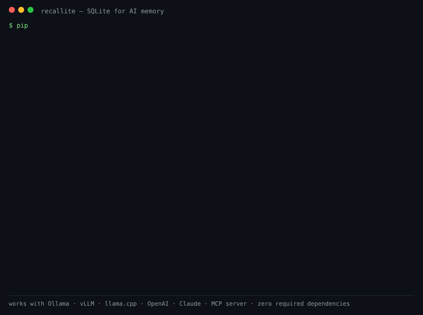

# 🧠 recallite

**SQLite for AI memory.** Give any LLM permanent memory — no fine-tuning, no model changes, zero required dependencies.



> **Formerly "memlayer"** — renamed before first PyPI release to avoid
> clashing with an unrelated, older package of the same name.

Type `/save my name is Ali and I am 36`, and from that moment on, *every* model you use — Ollama, vLLM, Hugging Face, anything — knows it. Memory lives in a fast local SQLite database and is injected into the prompt automatically (RAG-style).

```
You: /save my name is Ali and I am 36 years old
recallite: Saved [a1b2c3d4]

You: how old am I?
Assistant: You're 36, Ali!
```

## Why recallite?

- ⚡ **Hybrid retrieval pipeline** — BM25 when words matter ("invoice 4521"), embeddings when meaning matters ("favorite food" → biryani), fused with Reciprocal Rank Fusion — plus metadata filters, temporal ranking, deterministic query reformulation, adaptive top-k, optional cross-encoder reranking, and per-hit explanations. One SQLite file, no vector database. Semantic layer optional: `use_embeddings=True` or `embedder=OllamaEmbedder()` — zero pip installs if you already run Ollama.

  ```python
  store.search("what did I decide about deploys?",
               top_k="auto",                        # cut at the score cliff
               filters={"memory_type": "procedural", "min_confidence": 0.7},
               explain=True)                        # per-hit signal breakdown
  ```
- 🔌 **Works with everything** — Ollama, vLLM, LM Studio, llama.cpp server, OpenAI, Groq, or any Hugging Face model in-process. One line to switch backends; your memories follow you.
- 📦 **Zero required dependencies** — core is pure Python standard library. Optional extras add semantic search and in-process HF models.
- 👥 **Multi-user** — isolate memories per `user_id` in one database.
- 🔒 **Private by design** — local `.db` file you own, password-locked secure mode, and optional **AES-256-GCM encryption at rest** (`recallite[crypto]`): text, keywords, and embeddings encrypted; existing databases migrate in place.

## Install

```bash
pip install recallite                # core (stdlib only)
pip install "recallite[semantic]"    # + embedding reranking
pip install "recallite[huggingface]" # + run HF models in-process
pip install "recallite[crypto]"      # + encryption at rest (AES-256-GCM)
```

## Quickstart

### Ollama
```python
from recallite import MemoryStore, MemoryAgent, OllamaBackend

agent = MemoryAgent(MemoryStore("mem.db", user_id="ali"),
                    OllamaBackend("llama3.2"))
agent.repl()   # interactive chat with /save, /memories, /forget, /clear
```

### vLLM (or any OpenAI-compatible server)
```python
from recallite import MemoryStore, MemoryAgent, OpenAICompatBackend

backend = OpenAICompatBackend("meta-llama/Llama-3.2-3B-Instruct",
                              base_url="http://localhost:8000/v1")
agent = MemoryAgent(MemoryStore("mem.db"), backend)
print(agent.ask("what do you know about me?"))
```

### Claude (Anthropic)
```python
from recallite import MemoryStore, MemoryAgent, AnthropicBackend
# export ANTHROPIC_API_KEY=sk-ant-...
agent = MemoryAgent(MemoryStore("mem.db"), AnthropicBackend("claude-sonnet-4-6"))
agent.repl()
```

### OpenAI (ChatGPT models)
```python
import os
from recallite import MemoryStore, MemoryAgent, OpenAICompatBackend
backend = OpenAICompatBackend("gpt-4o-mini",
                              base_url="https://api.openai.com/v1",
                              api_key=os.environ["OPENAI_API_KEY"])
agent = MemoryAgent(MemoryStore("mem.db"), backend)
```

Ready-to-run scripts for every backend are in [`examples/`](examples/): `chat_ollama.py`, `chat_vllm.py`, `chat_openai.py`, `chat_claude.py`, `chat_hf.py` — all sharing the same memory format, so one `mem.db` follows you across every model.

### Hugging Face (in-process, no server)
```python
from recallite import MemoryStore, MemoryAgent, HuggingFaceBackend

agent = MemoryAgent(MemoryStore("mem.db"),
                    HuggingFaceBackend("Qwen/Qwen2.5-1.5B-Instruct"))
```

## Commands

| Command | What it does |
|---|---|
| `/save <keyword> <fact>` | Remember a fact under a keyword, e.g. `/save age Ali is 36` |
| `/memories` | List everything saved (with keywords) |
| `/forget <id>` | Delete one memory |
| `/clear` | Delete all memories |
| `/enable <password>` | Unlock memory in secure mode (first use sets the password) |
| `/lock` | Lock memory again |

## 🛡️ Guardrails

```python
from recallite import Guardrails, MemoryStore
guard = Guardrails(pii_mode="redact",          # allow | warn | redact | block
                   blocklist=["secretproject"], max_length=2000)
store = MemoryStore("mem.db", guardrails=guard)
```

- **Secure by default (v0.10)** — no `Guardrails` passed? You still get PII warnings, length limits, and the injection shield. `guardrails=False` is the explicit opt-out. The same validation runs on `/save`, `/import`, and `/task` alike; `/task` URLs get SSRF protection (private/loopback/metadata addresses refused, every redirect hop re-validated); security events land in a per-profile audit log (`store.audit_events()`).
- **PII filter** — detects emails, phones, credit cards (Luhn-verified), SSNs, IPs, API keys; block, redact, or warn
- **Prompt-injection shield** — memories containing "ignore previous instructions"-style patterns never reach the model prompt
- **Prohibited terms** — static `blocklist=[...]` plus a persistent list managed from chat: `/block projectx`, `/unblock projectx`, `/blocked` (survives restarts, works even without a Guardrails object)
- **NER (optional)** — ML detection of organizations, locations, and names that regex can't catch, via spaCy: `Guardrails(ner=True)`. Defaults to ORG + GPE only — add `"PERSON"` to `ner_entities` deliberately, since redacting names defeats a *personal* memory. `pip install "recallite[ner]" && python -m spacy download en_core_web_sm`
- **Length limits** — full control over what gets stored

## ⚡ Also included

Streaming responses • conversation history • contradiction detection with `/replace` and `/save!` • `/undo` • `/search` • `/stats` • `/export` & `/import` • memory expiry (`/save --expires 30d ...`) • multi-profile (`/profile work`) • CLI: `recallite chat --backend ollama --model llama3.2`

## 🔐 Secure mode

Turn it on with one flag:

```python
store = MemoryStore("mem.db", user_id="ali", secure=True)
```

While locked, `/save`, `/memories`, `/forget`, `/clear` are refused **and no
memories are injected into the prompt** — the model knows nothing about you
until you type `/enable <password>`. The first `/enable` sets the password;
passwords are stored as salted PBKDF2-SHA256 hashes (200k iterations), never
plain text. Restarting the app locks memory again automatically.

## How it works

1. `/save` writes the fact to SQLite (with an FTS5 index maintained by triggers).
2. On every normal message, recallite runs a BM25 search over your memories, optionally reranks with embeddings, and prepends the top hits to the system prompt.
3. The model answers as if it always knew you. Switch models freely — memory is model-agnostic.

## 🧠 Intelligent lifecycle (v0.11)

- **Memory types** — every fact is `semantic`, `preference`, `episodic`, or `procedural` (auto-classified, overridable: `/save --type preference ...`), each with a default **importance** that feeds ranking alongside confidence and recency.
- **Structured extraction** — `/auto on` now proposes up to 3 typed facts per message from a strict JSON schema, deduplicated against what you already saved; you confirm each one.
- **Semantic dedup** — with an embedder configured, "I am 36" vs "my age is 36" is caught as a duplicate even with no shared words.
- **Consolidation** — `/consolidate` proposes merging near-duplicates; `/consolidate apply` keeps the best record and supersedes the rest (history preserved). Nothing merges without you.
- **Temporal validity** — facts can carry `valid_from`/`valid_until`; ended facts become historical: out of search and prompts, kept in `/history`.
- **Retention & true deletion** — `/retention 90` auto-deletes superseded history after 90 days (active memories never auto-deleted); `/compact` rewrites the file so deleted rows leave no byte-level traces.

## 🧬 Memory lifecycle (v0.5)

Memories aren't just rows — they have a life:

- **Supersession** — `/replace <id> <kw> <fact>` marks the old fact `superseded` (kept as history, never injected) instead of deleting it. `/history city` shows the full chain: `Austin (old) → Dallas (ACTIVE)`. Retrieval only ever returns current truth.
- **Provenance & confidence** — every memory records its `source` (`user_explicit` 1.0, `user_conversation` 0.8, `tool_output` 0.7, `model_inferred` 0.4) so explicit facts outrank guesses.
- **Untrusted framing** — memories are injected inside `BEGIN/END UNTRUSTED USER MEMORY` markers with an explicit "data, not instructions" preamble: defense-in-depth on top of the injection shield.
- **Opt-in auto-extraction** — `/auto on` makes the model propose one memorable fact after your messages ("Worth remembering? Type: /save family ..."). Nothing is ever saved without your confirmation, and there's zero extra inference cost when off.
- **Recency-aware retrieval** — near-tied results prefer newer, higher-confidence memories; `last_accessed_at` tracks which memories actually get used.

## 🌐 Tasks: live data into memory (v0.6)

```
/task add weather forecast https://wttr.in/Dallas?format=3
/task run weather                 ← fetch → memory under keyword "forecast"
/task run weather                 ← tomorrow: SUPERSEDES yesterday's data
```

Fetched text is HTML-stripped, size-capped, saved with `tool_output`
provenance (0.7 confidence — never outranks what you typed), filtered by
your guardrails, and re-runs keep exactly one current version in the prompt.

## 🛡️ Privacy Gateway (v0.12) — vault-free Privacy Shield

Put recallite between your applications and ANY model: prompts are
sanitized before they leave your environment, with **no detokenization
vault anywhere** — see [docs/PRIVACY_SHIELD.md](docs/PRIVACY_SHIELD.md).

```bash
recallite gateway --upstream http://localhost:8000/v1 --mode tokenize --restore email
```

- **Three modes:** `redact` (irreversible), `tokenize` (opaque,
  session-scoped HMAC tokens; the mapping goes back to the caller who
  already owned the text — nothing persisted), authorized restore (trusted
  apps only, server-allowlisted categories only).
- **Structural never-restore:** SSNs and payment PANs are excluded from
  every mapping at detection time — no code path can return them.
  CVV/CVC content refuses the whole request and is never stored or
  forwarded.
- **Fail closed everywhere:** uninspectable content parts, detector
  failures, expired sessions, forged or model-invented tokens.
- **Output DLP:** raw sensitive values appearing in model responses are
  redacted and audited; streaming responses are fully scanned before
  emission (no chunk-boundary leakage).
- Acceptance tests capture every outbound payload from a mock upstream
  and prove original values are absent — plus auth, tenant/session
  isolation under concurrency, injection-cannot-disable-protection, and
  no-values-in-logs checks.

This reduces exposure; it does not make text provably anonymous, and it
does not by itself make a deployment HIPAA- or PCI-compliant — the
[architecture doc](docs/PRIVACY_SHIELD.md) states the limits plainly.

## 🔌 MCP server (v0.14): memory for Claude Desktop/Code, ChatGPT, Cursor

```bash
pip install "recallite[mcp]"
recallite mcp --db mem.db --user you            # stdio, for local clients
recallite mcp --transport http --port 8765      # streamable HTTP + Bearer auth
```

Six sanitized tools — `memory_search/save/update/delete`, `privacy_check`,
`policy_status` — every output privacy-redacted before the model sees it,
and **no restore tool exists by design**. v0.14 also hardens the gateway:
NER name detection (`--ner strict` fails closed), split chat/restore
credentials with tenant/category/destination scoping, server-minted
owner-enforced sessions, schema-aware tool-call sanitization, and
structured-response DLP. See [docs/PRIVACY_SHIELD.md](docs/PRIVACY_SHIELD.md).

## 📊 Benchmark (reproducible, one command)

```
pip install recallite && recallite bench
```

Every release must pass its own benchmark — it runs in CI and as a unit test.
Current results (seed 42, deterministic; `--full` mode, 5,000-memory corpus):

| category | score | threshold |
|---|---|---|
| recall@3 | 1.00 | ≥0.90 |
| semantic recall — lexical only | 0.00 | *info: why hybrid exists* |
| **semantic recall — hybrid** | **1.00** | ≥0.75 |
| exact-token match under hybrid | 1.00 | 1.00 |
| temporal correctness (latest fact wins) | 1.00 | 1.00 |
| contradiction handling (superseded never injected) | 1.00 | 1.00 |
| cross-profile privacy leakage | 0 leaks | 0 |
| injection resistance (5 hostile memories) | 1.00 | ≥0.80 |

Latency over 5,000 memories: lexical p50 ≈ 4 ms · hybrid p50 ≈ 3 ms warm; cold start (process open + first hybrid query) ≈ 8 ms. Tokens injected per query: ~100 of a 600 budget. v0.15 adds a **multi-session life-timeline evaluation** (three sessions over 60 days with supersessions; retrieval must return current truth and never the superseded past — threshold ≥0.85) and `recallite bench --compare old.json` for before/after deltas.

The default run uses a deterministic synonym-aware toy embedder (zero downloads) so anyone can reproduce bit-for-bit; `recallite bench --embedder ollama` or `--embedder st` measures real embedding models. `--json results.json` emits machine-readable output.

## ✅ UAT: acceptance tests against the REAL model (v0.9)

The benchmark proves the retrieval math; UAT proves the product. Every release
ships its acceptance prompts (`recallite/uat_prompts.json`) — each with an
expected result — and one command runs them against your actual model:

```bash
recallite uat --backend openai --model openai/gpt-oss-20b \
             --url http://localhost:8000/v1 --report uat_report.json
```

10 shipped cases cover recall, temporal correctness ("moved to Dallas" must
beat "lived in Austin"), command safety, PII redaction, secure-mode leakage
("while locked, the model must not know your bank"), injection obedience, and
no-memory honesty. The report records pass/fail per prompt with the failure
reason and reply excerpt, latency, which model answered, and the recallite
version; exit code 0 only on a clean pass, so it drops straight into cron:

```cron
0 2 * * * recallite uat --backend openai --model openai/gpt-oss-20b \
    --url http://localhost:8000/v1 \
    --report ~/uat-reports/uat-$(date +\%F).json >> ~/uat-reports/uat.log 2>&1
```

Secure-mode cases read their password from `--password-file`
(default `~/.recallite_uat_pass`, auto-created with a random value, chmod 600) —
prompt files never contain a secret; they reference `{PASSWORD}`.
Write your own cases in the same JSON format and pass `--prompts myfile.json`.

## 🧩 Framework integrations (v0.15)

```python
from recallite import MemoryStore, as_langchain_retriever, as_llamaindex_retriever
retriever = as_langchain_retriever(store, filters={"memory_type": "preference"},
                                   sanitize=True)   # redacts PII in results
docs = retriever.invoke("what food does the user like?")
```

Thin wrappers over recallite's own pipeline — hybrid retrieval, filters,
temporal ranking, and the explain signals arrive in each document's
metadata. `pip install "recallite[langchain]"` / `"recallite[llamaindex]"`.

## 📚 Documentation

- [docs/USAGE.md](docs/USAGE.md) — command reference + 7 worked use cases
- [docs/SECURITY.md](docs/SECURITY.md) — secure mode, password reset, guardrails, injection defenses
- [CHANGELOG.md](CHANGELOG.md) · [TESTING.md](TESTING.md)

## Roadmap

- [ ] Recall benchmark suite (temporal correctness, contradiction handling, injection resistance)
- [ ] Memory decay / importance scoring
- [ ] Streaming responses
- [ ] REST API server mode (`recallite serve`)
- [ ] LangChain / LlamaIndex integrations

## License

MIT — do whatever you want, a star ⭐ is appreciated.
